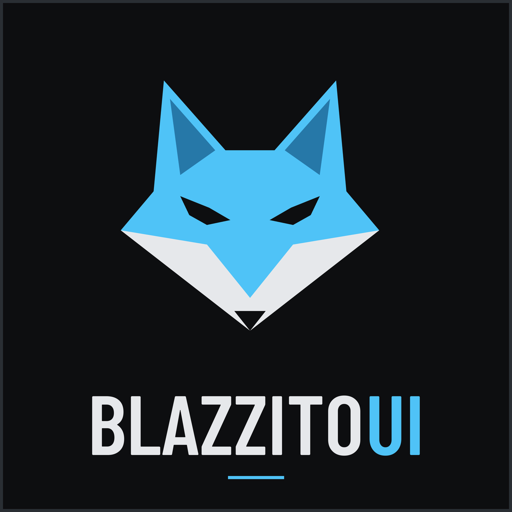
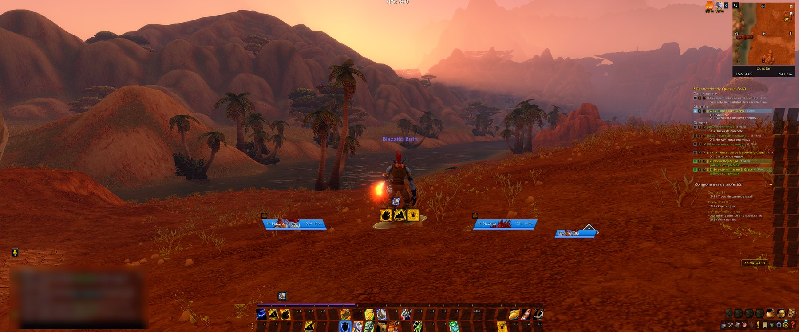
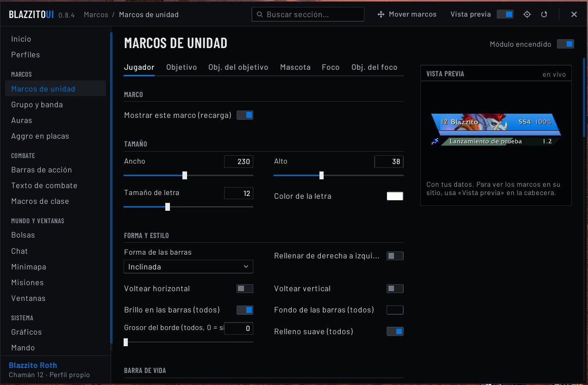
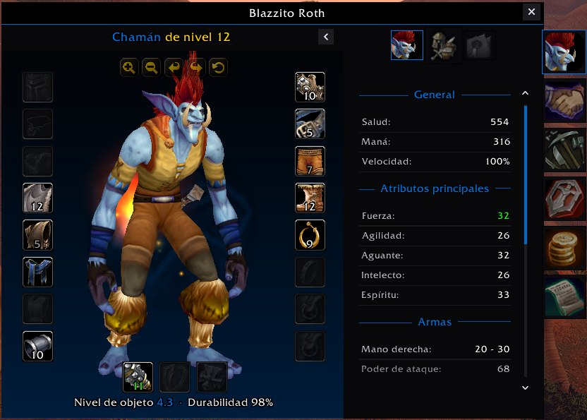
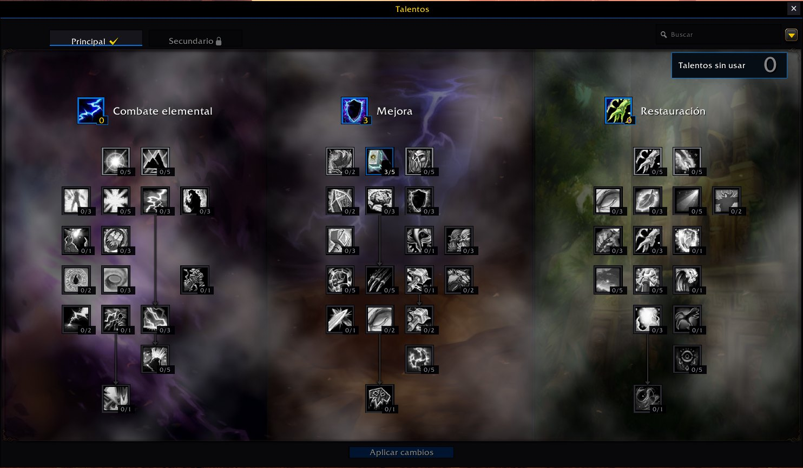
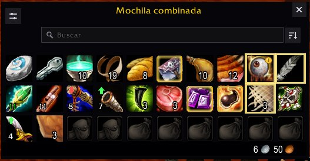
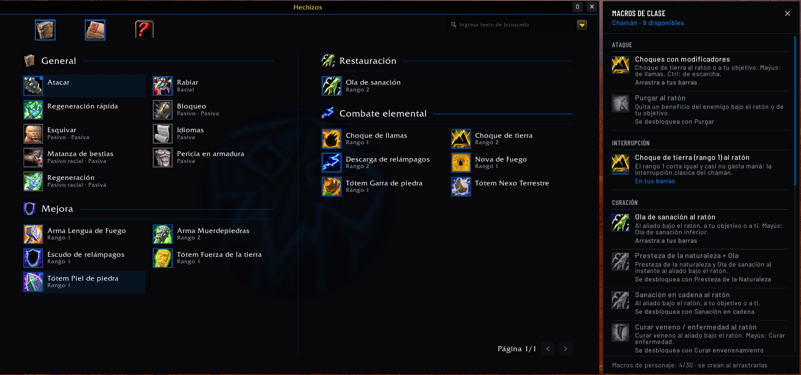

<div align="center">



# BLAZZITO UI

[English](README.md) · **Español**

**Una interfaz ligera y modular para World of Warcraft Forever**


</div>

---

Hola 👋 Esto es un proyecto personal: soy un jugador joven de WoW que quería una interfaz a su gusto,
para mí y para mis amigos. Nada más, sin pretensiones.

La idea es sencilla: **los marcos de Blizzard, pero con un aspecto limpio y oscuro**, y algunas
comodidades que echaba de menos. No reemplaza las ventanas del juego: las viste. Todo se maneja desde
una sola ventana de opciones (`/bui`) y cada parte se puede apagar si no te gusta.

🌐 **En español o en inglés**: por defecto usa el idioma de tu WoW, y lo puedes cambiar en `/bui` → Inicio → Idioma.



## 📸 Un vistazo

<table>
  <tr>
    <td width="50%"><br><sub><b>Opciones</b> · <code>/bui</code> con vista previa en vivo</sub></td>
    <td width="50%"><br><sub><b>Personaje</b> · nivel de objeto, durabilidad y estadísticas</sub></td>
  </tr>
  <tr>
    <td width="50%"><br><sub><b>Talentos</b> · los tres árboles con nuestro estilo</sub></td>
    <td width="50%"><br><sub><b>Bolsas</b> · nivel de objeto, mejoras y basura marcada</sub></td>
  </tr>
  <tr>
    <td colspan="2"><br><sub><b>Libro de hechizos unificado</b> y la ventana de <b>macros de clase</b> a su lado</sub></td>
  </tr>
</table>

## ✨ Qué incluye

BlazzitoUI está hecho de módulos. El núcleo es obligatorio y el resto lo activas o desactivas como quieras.

### 🧩 Núcleo — `BlazzitoUI`
- **Ventana de opciones** (`/bui`) con buscador, vista previa en vivo y el color de tu clase como acento.
- **Marcos de unidad**: jugador, objetivo, objetivo del objetivo, mascota, foco y objetivo del foco.
  Varias formas, retrato 2D o 3D, y **puntos de combo** con diseño propio para pícaros y druidas.
- **Mover marcos** (`/bui mover`) para colocar cada cosa donde quieras.
- **Perfiles por personaje**: copia los ajustes de otro personaje, o exporta e importa los tuyos.
- **Idioma**: español o inglés (automático según tu WoW, o el que elijas).
- **Comodidad**: botín rápido, reparación automática (con fondos de hermandad si los hay) y venta de basura.

### ⚔️ Barras de acción — `Blazzito_ActionBars`
- Las barras de Blizzard (1–8, mascota, posturas, bolsas, micromenú y experiencia) con nuestro estilo.
- Formas de botón, reglas de visibilidad y **temporizadores de golpe** (cuerpo a cuerpo y a distancia).

### 🛡️ Auras — `Blazzito_Auras`
- Beneficios y perjuicios en los marcos de unidad, como iconos o como barras.
- Marca para lo que puedes disipar, y el marco de beneficios de Blizzard con el mismo estilo.

### 🎒 Bolsas — `Blazzito_Bags`
- Bolsas y banco con borde del color de la calidad, **nivel de objeto** y **flechas de mejora**.
- Brillo en los objetos nuevos, huecos libres en el botón de la mochila y la basura marcada (se vende sola en el vendedor).
- **Acciones rápidas** con Alt+clic: desencantar, forzar cerraduras, prospectar o moler.
- **Basura junto al botín**: si tienes las bolsas llenas, al abrir un botín aparece tu basura con su precio y un botón para tirarla.
  Y un botón **«Recoger todo»** debajo de la ventana de botín.

### 💬 Chat — `Blazzito_Chat`
- Chat con nuestro estilo: copiar mensajes, historial, enlaces y comandos que se pueden pulsar, y emoticonos.

### 💥 Texto de combate — `Blazzito_CombatText`
- Texto de combate propio en arcos: daño y curas que haces y recibes, críticos, avisos, botín y rachas.
- Zonas que se pueden mover, iconos, varias fuentes con vista previa y un resumen al terminar el combate.

### 🎮 Mando — `Blazzito_Gamepad`
- Si entras con un mando conectado, te pregunta si quieres jugar con mando o con teclado y ratón.
- Estilo de BlazzitoUI sobre los botones de mando de Blizzard.

### 🖥️ Gráficos — `Blazzito_Graphics`
- Ajustes de gráficos de un clic (de **Más FPS** a **Máxima calidad**), copia de seguridad de los tuyos y límites de FPS.

### 👥 Grupo y banda — `Blazzito_Group`
- Marcos de grupo y banda con rol, disipables, alcance y amenaza.
- **Tus beneficios**: ves qué buffs tuyos lleva cada miembro, y en gris los que le faltan.

### 📜 Macros de clase — `Blazzito_Macros`
- Las macros esenciales de las 9 clases en una ventana junto al libro de hechizos.
- Se desbloquean al aprender la habilidad, se arrastran a las barras y algunas se actualizan solas
  (cambio de arma, comida de la mascota, mejores pociones, comer y beber…).

### 🧭 Minimapa — `Blazzito_Minimap`
- Formas, puntos cardinales, zona, hora y coordenadas, y los botones de otros addons recogidos.
- Y la **huella de tu mascota** 🐾

### 🎯 Placas de nombre — `Blazzito_Nameplates` y `Blazzito_ThreatPlate`
- Placas enemigas con nuestro estilo y aviso de alcance.
- Tu porcentaje de amenaza en cada placa.

### 🗺️ Misiones — `Blazzito_QuestTracker`
- Retoques sobre el rastreador de **Questie** (no lo reemplaza): destacar misiones, también desde el mapa.

### ⚙️ Ajustes entre personajes — `Blazzito_Setup`
- Copia la configuración del juego de tu personaje principal (barras, opciones, Edit Mode, addons activos)
  a los demás (`/blazz`).

### 🪟 Ventanas — `Blazzito_Windows`
- Las ventanas de Blizzard con nuestro estilo: **personaje** (calidad, nivel de objeto, durabilidad, estadísticas),
  reputación, habilidades, panel de la **mascota**, **talentos**, **mapa** y registro de misiones, entrenadores,
  botín, comerciante, correo, profesiones, subastas y menús desplegables.
- Un **libro de hechizos unificado** con pestañas de hechizos y mascota, que marca lo que aún no está en tus barras.

## 📦 Instalación

1. Descarga el último `.zip` desde [Releases](../../releases/latest).
2. Descomprímelo en:
   ```
   World of Warcraft\_forever_\Interface\AddOns
   ```
   Deben quedar las carpetas `BlazzitoUI` y `Blazzito_…` **directamente** dentro de `AddOns`.
3. Entra en el juego y escribe `/bui`.

**Para actualizar**, reemplaza las carpetas por las nuevas. Tus ajustes no se pierden, porque se guardan en la carpeta `WTF`.

> Hecho para **WoW Forever** (`## Interface: 16001`). En otras versiones del juego probablemente no funcione.

## ⌨️ Comandos

| Comando | Qué hace |
|---|---|
| `/bui` | Abre las opciones |
| `/bui mover` | Mover los marcos |
| `/bui reset` | Devolver los marcos a su posición |
| `/bui macros` | Ventana de macros de clase |
| `/bui mando` | Estado del mando |
| `/bui graficos` | Tus ajustes de gráficos actuales |
| `/blazz` | Copiar ajustes de tu main a otros personajes |

## 🤝 Se lleva bien con

Questie · PrettyTooltip · BlizzMove · OmniCC · DialogueUI · Leatrix Plus · WaypointUI · SkillUp

## 🙏 Créditos

- Fuentes **Barlow**, **Barlow Condensed**, **Changa**, **PT Sans Narrow** y **Russo One**, con licencia
  [SIL Open Font License 1.1](BlazzitoUI/Media/Fonts/FONTS-LICENSE.txt).
- Inspirado en la idea de una interfaz modular como EllesmereUI, pero mucho más pequeño y escrito desde cero.

---

<div align="center">

Hecho con cariño por **Blazzito** · para mí y mis amigos 🦊

</div>
