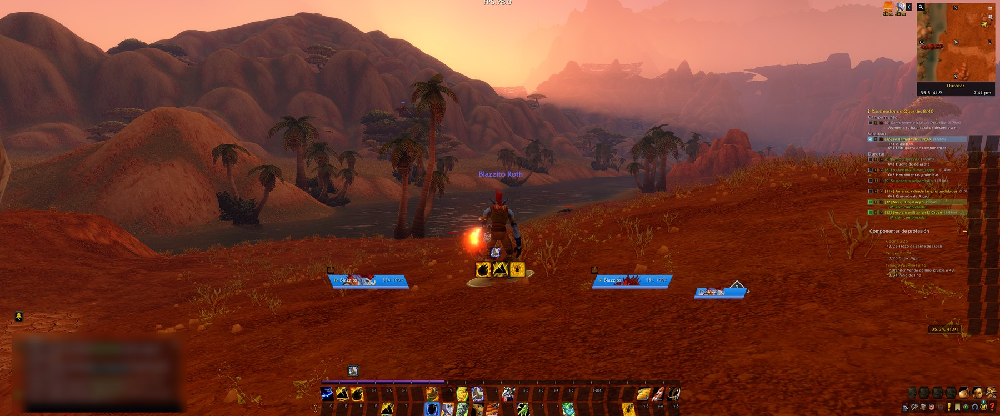
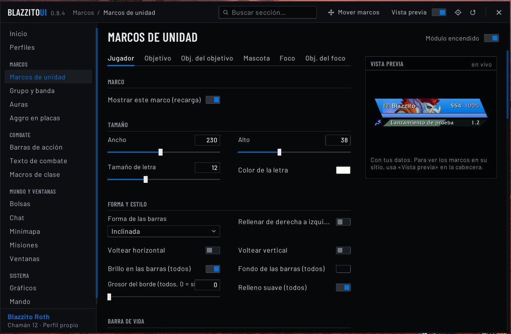
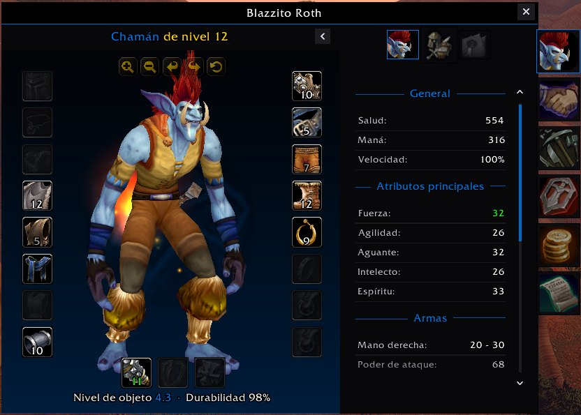
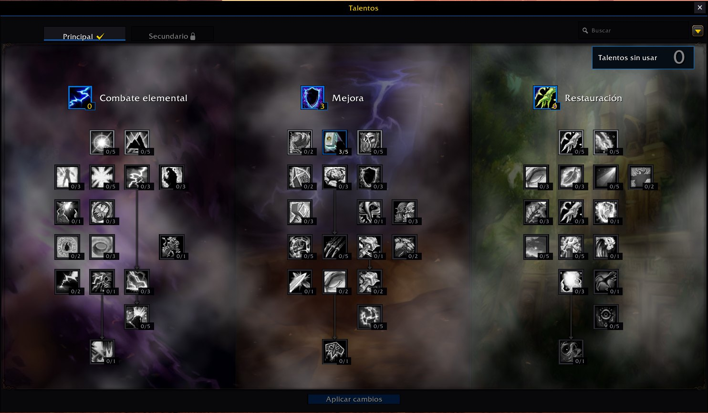
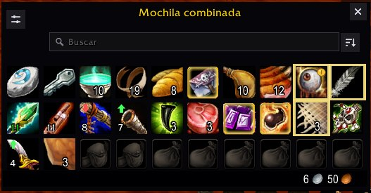
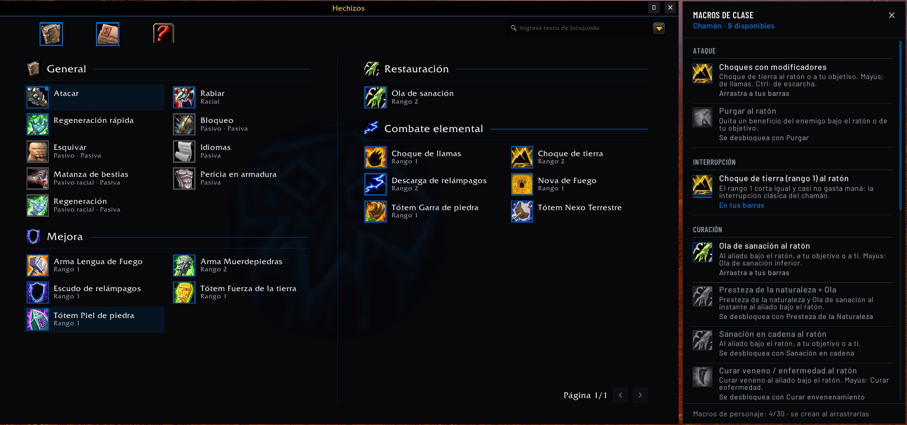

<div align="center">


# BLAZZITO UI

**English** · [Español](README.es.md)

**A light, modular interface for World of Warcraft Forever**


</div>

---

Hi 👋 This is a personal project: I'm a young WoW player who wanted an interface I really liked,
for me and my friends. That's all, no big pretensions.

The idea is simple: **Blizzard's own frames, with a clean dark look**, plus a few quality-of-life
touches I was missing. It doesn't replace the game's windows, it restyles them. Everything is set up
from one options window (`/bui`) and every part can be turned off if you don't like it.

🌐 **In English or Spanish**: it follows your WoW language by default, and you can change it in `/bui` → Home → Language.



## 📸 A quick look

<table>
  <tr>
    <td width="50%"><br><sub><b>Options</b> · <code>/bui</code> with a live preview</sub></td>
    <td width="50%"><br><sub><b>Character</b> · item level, durability and stats</sub></td>
  </tr>
  <tr>
    <td width="50%"><br><sub><b>Talents</b> · the three trees in our style</sub></td>
    <td width="50%"><br><sub><b>Bags</b> · item level, upgrades and marked junk</sub></td>
  </tr>
  <tr>
    <td colspan="2"><br><sub><b>Unified spellbook</b> with the <b>class macros</b> window next to it</sub></td>
  </tr>
</table>

<sub>Screenshots taken with the interface in Spanish.</sub>

## ✨ What's inside

BlazzitoUI is split into modules. The core is required; everything else can be turned on or off as you like.

### 🧩 Core — `BlazzitoUI`
- **Options window** (`/bui`) with search, live preview and your class color as the accent.
- **Unit frames**: player, target, target of target, pet, focus and focus target.
  Several shapes, 2D or 3D portraits, and custom **combo points** for rogues and druids.
- **Move frames** (`/bui mover`) to put everything where you want it.
- **Per-character profiles**: copy another character's settings, or export and import your own.
- **Language**: English or Spanish (automatic from your WoW, or the one you pick).
- **Quality of life**: fast loot, auto repair (with guild funds when available) and auto-selling junk.

### ⚔️ Action bars — `Blazzito_ActionBars`
- Blizzard's bars (1–8, pet, stances, bags, micro menu and experience) in our style.
- Button shapes, visibility rules and **swing timers** (melee and ranged).

### 🛡️ Auras — `Blazzito_Auras`
- Buffs and debuffs on the unit frames, as icons or bars.
- A mark for what you can dispel, and Blizzard's buff frame in the same style.

### 🎒 Bags — `Blazzito_Bags`
- Bags and bank with quality-colored borders, **item level** and **upgrade arrows**.
- New-item glow, free slots on the backpack button and marked junk (sold automatically at vendors).
- **Quick actions** with Alt+click: disenchant, pick locks, prospect or mill.
- **Junk next to the loot window**: when your bags are full, opening loot shows your junk with its price and a button to destroy it.
  Plus a **"Loot all"** button under the loot window.

### 💬 Chat — `Blazzito_Chat`
- Chat in our style: copy messages, history, clickable links and commands, and emotes.

### 💥 Combat text — `Blazzito_CombatText`
- Its own floating combat text in arcs: damage and healing in and out, crits, alerts, loot and streaks.
- Movable zones, icons, several fonts with a preview and a summary when combat ends.

### 🎮 Gamepad — `Blazzito_Gamepad`
- If you log in with a controller connected, it asks whether you want gamepad or keyboard and mouse.
- BlazzitoUI's style on top of Blizzard's gamepad buttons.

### 🖥️ Graphics — `Blazzito_Graphics`
- One-click graphics presets (from **More FPS** to **Max quality**), a backup of your own settings and FPS limits.

### 👥 Party & raid — `Blazzito_Group`
- Party and raid frames with role, dispels, range and threat.
- **Your buffs**: see which of your buffs each member has, and the missing ones in grey.

### 📜 Class macros — `Blazzito_Macros`
- Essential macros for all 9 classes, in a window next to the spellbook.
- They unlock as you learn the spell, you drag them to your bars, and some update themselves
  (weapon swap, pet food, best potions, eat and drink…).

### 🧭 Minimap — `Blazzito_Minimap`
- Shapes, cardinal points, zone, clock and coordinates, and other addons' buttons tidied up.
- And your **pet's paw print** 🐾

### 🎯 Nameplates — `Blazzito_Nameplates` and `Blazzito_ThreatPlate`
- Enemy nameplates in our style with a range warning.
- Your threat percentage on each plate.

### 🗺️ Quests — `Blazzito_QuestTracker`
- Touches on top of **Questie**'s tracker (it doesn't replace it): highlight quests, also from the map.

### ⚙️ Settings across characters — `Blazzito_Setup`
- Copies your main's game settings (bars, options, Edit Mode, enabled addons) to your other characters (`/blazz`).

### 🪟 Windows — `Blazzito_Windows`
- Blizzard's windows in our style: **character** (quality, item level, durability, stats), reputation, skills,
  **pet** panel, **talents**, **map** and quest log, trainers, loot, merchant, mail, professions, auction house
  and dropdown menus.
- A **unified spellbook** with spells and pet tabs that marks what isn't on your bars yet.

## 📦 Installation

1. Download the latest `.zip` from [Releases](../../releases/latest).
2. Unzip it into:
   ```
   World of Warcraft\_forever_\Interface\AddOns
   ```
   The `BlazzitoUI` and `Blazzito_…` folders must end up **directly** inside `AddOns`.
3. Log in and type `/bui`.

**To update**, replace the folders with the new ones. Your settings are kept, because they live in the `WTF` folder.

> Made for **WoW Forever** (`## Interface: 16001`). It probably won't work on other versions of the game.

## ⌨️ Commands

| Command | What it does |
|---|---|
| `/bui` | Opens the options |
| `/bui mover` | Move the frames |
| `/bui reset` | Put the frames back in their place |
| `/bui macros` | Class macros window |
| `/bui mando` | Gamepad status |
| `/bui graficos` | Your current graphics settings |
| `/blazz` | Copy your main's settings to other characters |

## 🤝 Plays well with

Questie · PrettyTooltip · BlizzMove · OmniCC · DialogueUI · Leatrix Plus · WaypointUI · SkillUp

## 🙏 Credits

- Fonts **Barlow**, **Barlow Condensed**, **Changa**, **PT Sans Narrow** and **Russo One**, under the
  [SIL Open Font License 1.1](BlazzitoUI/Media/Fonts/FONTS-LICENSE.txt).
- Inspired by the idea of a modular interface like EllesmereUI, but much smaller and written from scratch.

---

<div align="center">

Made with love by **Blazzito** · for me and my friends 🦊

</div>
